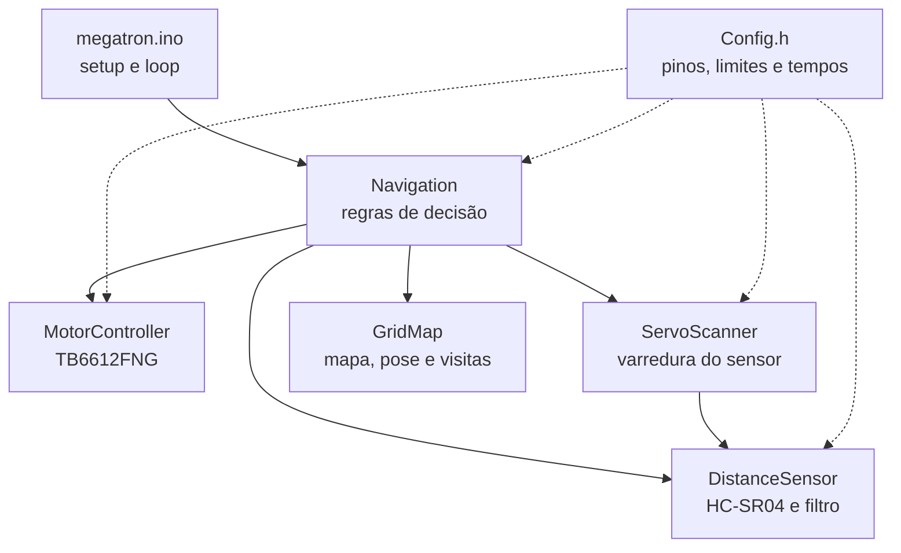
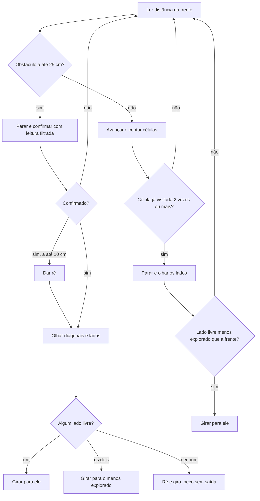

# Documentação técnica: robô explorador Megatron

Este documento descreve a arquitetura, os algoritmos e o roteiro de testes do robô. Ele serve de base para as Partes 3 (Projeto e Implementação) e 4 (Testes e Análise Crítica) do relatório. Montagem, pinagem e calibração estão em [LEIA_PRIMEIRO.md](LEIA_PRIMEIRO.md).

## 1. Requisitos do Grupo 4 e onde são atendidos

| Requisito | Onde está |
|---|---|
| Registro simplificado das regiões ou pontos percorridos | `GridMap`: cada célula guarda o estado (desconhecida, livre, obstáculo) e o número de passagens do robô (seção 4). |
| Mecanismo para reduzir repetição de trajetórias | `Navigation::avoidRepetition()` e `Navigation::compareExploration()` (seção 5). |
| Análise do comportamento durante a exploração | Linhas `STATS` em CSV no Monitor Serial e roteiro de testes (seções 6 e 7). |
| Documentação técnica e demonstração funcional | Este documento e o `LEIA_PRIMEIRO.md`. A demonstração é feita com o protótipo. |
| Representação simplificada do ambiente ou do percurso | Mapa em grade impresso no Monitor Serial (seção 4). |

## 2. Arquitetura

O software é dividido em módulos com uma responsabilidade cada. A navegação é a única que toma decisões; os demais módulos só executam ou medem.



## 3. Ciclo de navegação

A cada volta do `loop()`, `Navigation::update()` faz uma leitura rápida da frente e decide:



## 4. Mapa em grade e registro do percurso

- **Grade:** 21 × 21 células. O robô começa no centro, voltado para o norte.
- **Estado de cada célula:** desconhecida, livre ou obstáculo. Obstáculos vistos à frente, à esquerda e à direita são gravados na célula vizinha correspondente.
- **Passagens:** cada célula livre guarda quantas vezes o robô entrou nela. Esse é o registro do percurso: células com número alto são regiões por onde ele repetiu caminho.
- **Pose estimada por tempo:** a cada `TEMPO_POR_CELULA_MS` (500 ms) de avanço, o robô anda uma célula; ao parar, conta a célula em andamento se já percorreu metade dela. Cada giro muda o sentido em 90°. Sem encoders, a pose é aproximada. Para reduzir o erro acumulado, uma célula em que o robô entra passa a ser livre, mesmo que antes estivesse marcada como obstáculo.

**Legenda do mapa impresso no Monitor Serial:**

| Símbolo | Significado |
|---|---|
| `.` | célula desconhecida |
| `#` | obstáculo |
| `1` a `9` | célula livre e número de passagens (9 = nove ou mais) |
| `^` `>` `v` `<` | robô e o sentido em que está (norte, leste, sul, oeste) |

Abaixo do mapa sai um resumo com as contagens, a posição relativa ao início e a direção.

## 5. Mecanismo de anti-repetição

O robô usa o mapa em dois momentos:

1. **Diante de um obstáculo, com os dois lados livres.** Ele escolhe o lado com mais células desconhecidas nas próximas 3 células (`ALCANCE_AVALIACAO`). Se empatar, escolhe o lado com menos passagens nessas células. Se empatar de novo, escolhe o lado com mais espaço medido e, por último, alterna o lado preferido.
2. **Durante o avanço, ao entrar numa área repetida.** Quando a célula atual já tem `LIMITE_REVISITAS` passagens ou mais (padrão 2), o robô para e olha os lados. Ele só vira se um lado estiver livre **e** levar a uma área menos explorada que a da frente, pelo mesmo critério do item 1. Caso contrário, segue em frente. Para não parar a cada célula, essa verificação ocorre no máximo a cada `CELULAS_ENTRE_VERIFICACOES` células (padrão 3).

A verificação durante o avanço e o critério de visitas só funcionam com `EVITAR_REPETICAO = true` no `Config.h` (desligada por padrão; veja as chaves de comportamento no `LEIA_PRIMEIRO.md`). Os dois usos compartilham `compareExploration()`. Com `EVITAR_REPETICAO = false`, a verificação durante o avanço é desligada e a escolha de lado volta a considerar só as células desconhecidas, como na versão anterior. Isso permite comparar os dois comportamentos nos testes.

## 6. Métricas para a análise (linhas STATS)

Ao ligar, o robô imprime o cabeçalho e, a cada impressão do mapa, uma linha CSV:

```
STATS,tempo_ms,visitadas,revisitas,obstaculos,giros,res,desvios_repeticao
```

| Coluna | Significado |
|---|---|
| `tempo_ms` | tempo desde que a placa ligou |
| `visitadas` | células diferentes por onde o robô passou (área explorada) |
| `revisitas` | passagens além da primeira em cada célula (quanto ele repetiu caminho) |
| `obstaculos` | células marcadas como obstáculo |
| `giros` | giros de 90° realizados |
| `res` | manobras de ré |
| `desvios_repeticao` | giros causados pelo mecanismo de anti-repetição |

**Como coletar:** ao fim de um teste, copie o conteúdo do Monitor Serial, mantenha só as linhas que começam com `STATS` e cole numa planilha, usando vírgula como separador. Gráficos úteis para o relatório:

- `visitadas` × `tempo_ms`: velocidade de exploração;
- `revisitas` × `tempo_ms`: quanto o robô repete caminho;
- razão `revisitas / visitadas` ao fim do teste: eficiência da exploração (quanto menor, melhor).

Para mostrar o efeito do anti-repetição, repita o mesmo cenário com `EVITAR_REPETICAO = true` e `false`, pelo mesmo tempo, e compare as métricas.

## 7. Roteiro de testes

Use sempre o mesmo ponto de partida, a mesma direção inicial e o mesmo tempo de teste (por exemplo, 3 minutos). Fotografe ou desenhe o ambiente real para comparar com o mapa impresso.

| # | Cenário | O que observar | Anti-repetição | Visitadas | Revisitas | Giros | Rés | Observações |
|---|---|---|---|---|---|---|---|---|
| 1 | Corredor reto com parede no fim | parada, escolha de lado, mapa coerente com o corredor | ligado | | | | | |
| 2 | Sala com um obstáculo no centro | contorno do obstáculo, cobertura da sala | ligado | | | | | |
| 3 | Mesma sala do cenário 2 | comparação com o cenário 2 | desligado | | | | | |
| 4 | Beco sem saída (caixa em U) | ré, giro e saída do beco | ligado | | | | | |
| 5 | Ambiente em U ou L | se o robô evita voltar pelo mesmo braço | ligado | | | | | |

Para cada teste, registrar também: se houve colisão, se o robô travou e quanto o mapa impresso diverge do ambiente real.

## 8. Limitações conhecidas

- **Pose por tempo:** derrapagem, nível da bateria e giros que não dão exatamente 90° acumulam erro no mapa. Calibre `TEMPO_POR_CELULA_MS` e `TEMPO_GIRO_MS` com o robô real.
- **Sensor único e direcional:** o HC-SR04 tem feixe largo e não detecta bem objetos pequenos, inclinados ou macios. Ausência de eco conta como livre (`SEM_ECO_LIVRE = true`).
- **Mapa local:** a decisão olha só 3 células adiante em cada direção. Não há planejamento de rota até a área desconhecida mais próxima (busca de fronteira), que seria a evolução natural.
- **Grade limitada:** 21 × 21 células; ao chegar à borda, a pose deixa de avançar no mapa.
- **Sem detecção traseira:** a ré é feita sem medir o que há atrás do robô.
